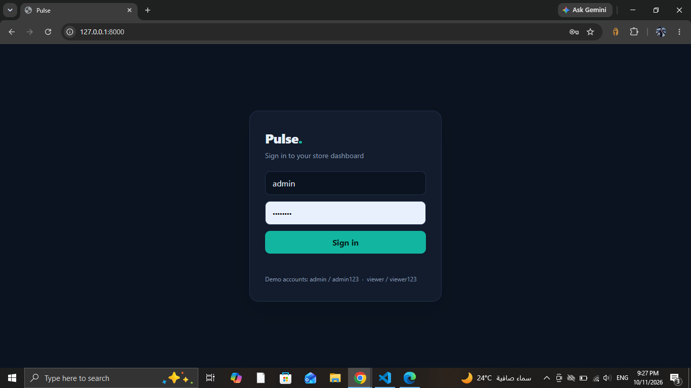

# Pulse: Smart Store Dashboard

A demo dashboard for online store owners. Instead of raw tables, Pulse tells
the owner what happened and what to do today.

> Demo project with generated sample data.

## Features
- JWT login with roles (admin / viewer)
- Revenue, profit and orders overview with a 30-day sales chart
- Product table with search and low-stock filter
- "Today" cards: low stock alerts, sales drops, top product, profit opportunities
- Daily summary written from live data
- Light and dark mode

## Tech stack
Python, FastAPI, SQLAlchemy, SQLite, JWT, HTML/CSS/JavaScript, Chart.js

## Screenshots

## Run locally
    git clone https://github.com/اسمك/pulse-dashboard.git
    cd pulse-dashboard
    python -m venv venv
    venv\Scripts\activate
    pip install -r requirements.txt
    python seed_data.py
    uvicorn main:app --reload

Open http://127.0.0.1:8000 and sign in with `admin / admin123`.

## Author
Ammar | Python Full-Stack Developer